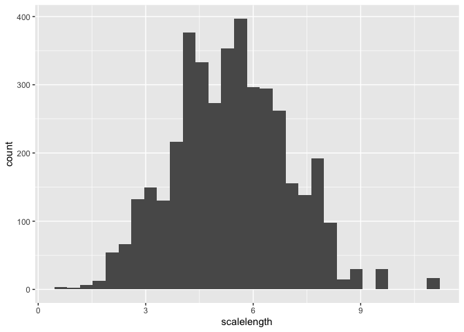
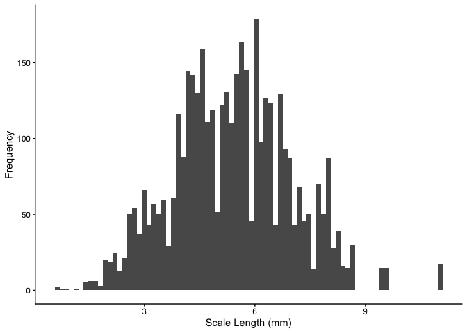

# Week10: Fish Analysis
Cielo De La Rosa

### Problem 2:

Load the tidyverse and the dataset.

``` r
# install.packages("tidyverse")
library(tidyverse)
```

    ── Attaching core tidyverse packages ──────────────────────── tidyverse 2.0.0 ──
    ✔ dplyr     1.2.1     ✔ readr     2.2.0
    ✔ forcats   1.0.1     ✔ stringr   1.6.0
    ✔ ggplot2   4.0.3     ✔ tibble    3.3.1
    ✔ lubridate 1.9.5     ✔ tidyr     1.3.2
    ✔ purrr     1.2.2     
    ── Conflicts ────────────────────────────────────────── tidyverse_conflicts() ──
    ✖ dplyr::filter() masks stats::filter()
    ✖ dplyr::lag()    masks stats::lag()
    ℹ Use the conflicted package (<http://conflicted.r-lib.org/>) to force all conflicts to become errors

``` r
# read in dataset

fish_data <- read_csv("../data/Gaeta_etal_CLC_data.csv")
```

    Rows: 4033 Columns: 6
    ── Column specification ────────────────────────────────────────────────────────
    Delimiter: ","
    chr (2): lakeid, annnumber
    dbl (4): fish_id, length, radii_length_mm, scalelength

    ℹ Use `spec()` to retrieve the full column specification for this data.
    ℹ Specify the column types or set `show_col_types = FALSE` to quiet this message.

Observe the dataset using head() and names()

``` r
head(fish_data)
```

    # A tibble: 6 × 6
      lakeid fish_id annnumber length radii_length_mm scalelength
      <chr>    <dbl> <chr>      <dbl>           <dbl>       <dbl>
    1 AL         299 EDGE         167            2.70        2.70
    2 AL         299 2            167            2.04        2.70
    3 AL         299 1            167            1.31        2.70
    4 AL         300 EDGE         175            3.02        3.02
    5 AL         300 3            175            2.67        3.02
    6 AL         300 2            175            2.14        3.02

``` r
names(fish_data) 
```

    [1] "lakeid"          "fish_id"         "annnumber"       "length"         
    [5] "radii_length_mm" "scalelength"    

Summary statistics for fish scale length:

using summarize() to get the min, max, and average of scale length

``` r
fish_data |> 
  summarize(min_scale_length = min(scalelength, na.rn = T),
            max_scale_length = max(scalelength, na.rm = T),
            mean_scale_length = mean(scalelength, na.rm = T))
```

    # A tibble: 1 × 3
      min_scale_length max_scale_length mean_scale_length
                 <dbl>            <dbl>             <dbl>
    1            0.628             11.0              5.38

### Problem 3:

``` r
# comitting multiple files
# creaye a new data frame that does not include fish w/ scale lengths less than 1mm from fish_data. will have 4,029 rows

fish_data_new <- fish_data |> 
  filter(scalelength >= 1)
fish_data_new 
```

    # A tibble: 4,029 × 6
       lakeid fish_id annnumber length radii_length_mm scalelength
       <chr>    <dbl> <chr>      <dbl>           <dbl>       <dbl>
     1 AL         299 EDGE         167            2.70        2.70
     2 AL         299 2            167            2.04        2.70
     3 AL         299 1            167            1.31        2.70
     4 AL         300 EDGE         175            3.02        3.02
     5 AL         300 3            175            2.67        3.02
     6 AL         300 2            175            2.14        3.02
     7 AL         300 1            175            1.23        3.02
     8 AL         301 EDGE         194            3.34        3.34
     9 AL         301 3            194            2.97        3.34
    10 AL         301 2            194            2.29        3.34
    # ℹ 4,019 more rows

``` r
write_csv(fish_data_new, "../data/fish_data_new.csv")

#commit this change to version control and make use it is now in github 
```

``` r
ggplot(fish_data, aes(x = scalelength)) +
  geom_histogram()
```

    `stat_bin()` using `bins = 30`. Pick better value `binwidth`.



``` r
# 4. modify code to look at narrower range of scale size classes by setting the bins argument to 80.
scale_hist_by_length <- ggplot(fish_data, aes(x = scalelength)) +
  geom_histogram(bins = 80) +
  labs(x = "Scale Length (mm)", y = "Frequency") +
  theme_classic()
# 5. save changes to code 
scale_hist_by_length
```



``` r
# 5. save this new plot using ggsave() 
ggsave("scale_hist_by_length.png", 
       plot = scale_hist_by_length,
       path = "../plots")
```

    Saving 7 x 5 in image
