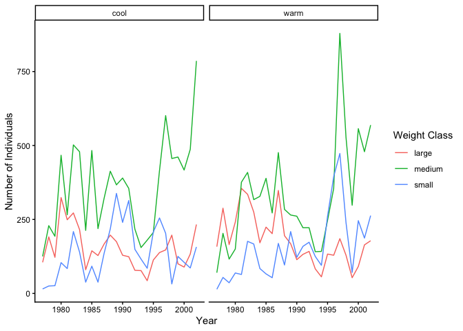

# Week 12 Assignment


# Assignment

### Purpose

The goal of this assignment is to practice writing and using conditional
statements, `if_else` and `case_when`, and `if`-`else` statements, and
to combine them with skills from earlier in the semester (joins,
strings, and plotting).

### Task

Write R code to successfully answer each question below.

### Criteria for Success

- Code is within the provided code chunks or new code chunks are created
  where necessary
- Code chunks run without errors
- Code chunks have brief comments indicating which code is answering
  which part of the question
- Code will be assessed as follows:
  - Produces the correct answer using the requested approach: 100%
  - Generally uses the right approach, but a minor mistake results in an
    incorrect answer: 90%
  - Attempts to solve the problem and makes some progress using the core
    concept, but returns the wrong answer and does not demonstrate
    comfort with the core concept: 50%
  - Answer demonstrates a lack of understanding of the core concept: 0%
- Any questions requiring written answers are answered with sufficient
  detail

### Due Date

November 17 before class

``` r
library(tidyverse)
```

    ── Attaching core tidyverse packages ──────────────────────── tidyverse 2.0.0 ──
    ✔ dplyr     1.2.1     ✔ readr     2.2.0
    ✔ forcats   1.0.1     ✔ stringr   1.6.0
    ✔ ggplot2   4.0.3     ✔ tibble    3.3.1
    ✔ lubridate 1.9.5     ✔ tidyr     1.3.2
    ✔ purrr     1.2.2     
    ── Conflicts ────────────────────────────────────────── tidyverse_conflicts() ──
    ✖ dplyr::filter() masks stats::filter()
    ✖ dplyr::lag()    masks stats::lag()
    ℹ Use the conflicted package (<http://conflicted.r-lib.org/>) to force all conflicts to become errors

# Assignment Exercises

### 1. Choice Operators (10 pts)

Create the following variables by running the code chunk below.

``` r
w <- 10.2
x <- 1.3
y <- 2.8
z <- 17.5
colors <- c("red", "blue", "green")
masses <- c(45.2, 36.1, 27.8, 81.6, 42.4)
```

Using the variables above, write code that determines whether the
following statements are `TRUE` or `FALSE`.

1.  `"green"` is in `colors`
2.  `"purple"` is not in `colors`
3.  Each value in `masses` is greater than 40.
4.  `w` is greater than `x`, or `y` is greater than `z`
5.  `x` times `w` is between 13.2 and 13.5

``` r
# 1a. "green" is in colors 
"green" %in% colors 
```

    [1] TRUE

``` r
# 1b. "purple is not in colors
!"purple" %in% colors
```

    [1] TRUE

``` r
# 1c. each value in masses is greater than 40 
masses > 40 
```

    [1]  TRUE FALSE FALSE  TRUE  TRUE

``` r
# 1d. w is greater than x, or y > z 
w > x | y > z 
```

    [1] TRUE

``` r
# 1e. x times w is between 13.2 and 13.5 
x*w > 13.2 & x*w <13.5
```

    [1] TRUE

### 2. Using `dplyr` Choice Functions (20 points)

For this question, we will be using functions from `dplyr` (part of the
`tidyverse`) and data from the `lterdatasampler` package, so make sure
you load both of those packages with the `library()` function.

First, create an object called `crab_size` and assign the value 17 to
it.

1.  Use the `if_else` function from `dplyr` to say that a crab that is
    larger than or equal to 20 is “large” and a crab that is smaller
    than 20 is “small.”

``` r
crab_size <- 17 
# 2a. crab is larger than or equal to 20 is "large", and "small" 
if_else(crab_size >= 20, true = "large", false = "small")
```

    [1] "small"

1.  Use the `case_when` function to say that if a crab is greater than
    or equal to 20, it is “large;” if greater than or equal to 10 but
    less than 20, it is “medium;” and if it is smaller than 10, it is
    “small.” Make sure that your `crab_size` object is still set to 17.

``` r
# 2b. 
case_when(crab_size >= 20 ~ "large", 
          crab_size >=10 & crab_size < 20 ~ "medium", 
          crab_size < 10 ~ "small")
```

    [1] "medium"

1.  Take a look at the `pie_crab` dataset from the `lterdatasampler`
    package by running `head(pie_crab)`. We want to create a new column
    based on the `size` column. Using the `if_else` function inside of a
    `mutate` function, create a new column called `size_category` based
    on the same conditions as (a).

    I’ve placed my new column next to the size column for the sake of
    the answer key; you don’t need to do this.

``` r
# 2c.  
#install.packages(lterdatasampler)
library(lterdatasampler)
# head(pie_crab)

pie_crab |>  
  mutate(size_category = if_else(size >= 20, 
                                 true = "large", 
                                 false = "small"), 
         .after = size)
```

    # A tibble: 392 × 10
       date       latitude site   size size_category air_temp air_temp_sd water_temp
       <date>        <dbl> <chr> <dbl> <chr>            <dbl>       <dbl>      <dbl>
     1 2016-07-24       30 GTM    12.4 small             21.8        6.39       24.5
     2 2016-07-24       30 GTM    14.2 small             21.8        6.39       24.5
     3 2016-07-24       30 GTM    14.5 small             21.8        6.39       24.5
     4 2016-07-24       30 GTM    12.9 small             21.8        6.39       24.5
     5 2016-07-24       30 GTM    12.4 small             21.8        6.39       24.5
     6 2016-07-24       30 GTM    13.0 small             21.8        6.39       24.5
     7 2016-07-24       30 GTM    10.3 small             21.8        6.39       24.5
     8 2016-07-24       30 GTM    11.2 small             21.8        6.39       24.5
     9 2016-07-24       30 GTM    12.7 small             21.8        6.39       24.5
    10 2016-07-24       30 GTM    14.6 small             21.8        6.39       24.5
    # ℹ 382 more rows
    # ℹ 2 more variables: water_temp_sd <dbl>, name <chr>

1.  Now use the `case_when` function inside a `mutate` function to
    create a new column called `size_category3` in the `pie_crab` data
    frame that meets the same conditions as (b).

    I’ve placed my new column next to the size column for the sake of
    the answer key; you don’t need to do this.

``` r
# 2d. 
pie_crab |> 
  mutate(size_category3 = case_when(size >=20 ~ "large", 
                                    size >=10 & size < 20 ~ "medium", 
                                    size < 10 ~ "small"),
         .after = size)
```

    # A tibble: 392 × 10
       date       latitude site   size size_category3 air_temp air_temp_sd
       <date>        <dbl> <chr> <dbl> <chr>             <dbl>       <dbl>
     1 2016-07-24       30 GTM    12.4 medium             21.8        6.39
     2 2016-07-24       30 GTM    14.2 medium             21.8        6.39
     3 2016-07-24       30 GTM    14.5 medium             21.8        6.39
     4 2016-07-24       30 GTM    12.9 medium             21.8        6.39
     5 2016-07-24       30 GTM    12.4 medium             21.8        6.39
     6 2016-07-24       30 GTM    13.0 medium             21.8        6.39
     7 2016-07-24       30 GTM    10.3 medium             21.8        6.39
     8 2016-07-24       30 GTM    11.2 medium             21.8        6.39
     9 2016-07-24       30 GTM    12.7 medium             21.8        6.39
    10 2016-07-24       30 GTM    14.6 medium             21.8        6.39
    # ℹ 382 more rows
    # ℹ 3 more variables: water_temp <dbl>, water_temp_sd <dbl>, name <chr>

### 3. If/Else Statements (20 points)

1.  Complete the following `if` statement so that if `age_class` is
    equal to “sapling” it sets `y` to 10, if `age_class` is equal to
    “seedling” it sets `y` to 5, and if `age_class` is something else it
    sets `y` to 0.

``` r
# 3a. if age_class is sampling set y to 10, if seedling set y to 5, everything else to 0 

age_class <- "adult" 
# age_class <- "seedling"
# age_class <- "sapling"

if (age_class == "sapling"){
  y <- 10
} else if (age_class == "seedling"){ 
  y <-  5} else {
    y <-  0
  }
y # returns 0 when age_class is adult 
```

    [1] 0

2.  Convert your conditional statement from (a) into a function that
    takes `age_class` as an argument and returns `y`. Call this function
    5 times, once with each of the following values for `age_class`:
    “sapling”, “seedling”, “adult”, “mature”, “established”.

3.  Write a function called `predict_value` that takes a single argument
    `x`. If `x` is greater than 0 and less than 15, return
    `y = 6 + 0.8 * x`. If `x` is greater than or equal to 15 and less
    than 30, return `y = 5 + 0.75 * x`. In all other cases, return
    `y = NA`. Call the function three times, with `5`, `26`, and `-2` as
    the input.

``` r
# 3b. make function using statement from a 
age_function <- function(age_class) {
  if (age_class == "sapling") {
    y <- 10 
  } else if (age_class == "seedling") {
    y <- 5
  } else {
    y <- 0
  }
  return(y)
}

age_function("sapling") 
```

    [1] 10

``` r
age_function("seedling")
```

    [1] 5

``` r
age_function("adult") 
```

    [1] 0

``` r
age_function("mature")
```

    [1] 0

``` r
age_function("established")
```

    [1] 0

``` r
# 3c. make function w/ a single argument x. If x is greater than 0 and less than 15, return y = 6 + 0.8 * x. If x is greater than or equal to 15 and less than 30, return y = 5 + 0.75 * x. In all other cases, return y = NA. 

predict_value <- function(x) {
  if (x > 0 & x < 15) { 
    y = 6 + 0.8 * x
  } else if ( x >= 15 & x < 30) { 
    y = 5 + 0.75 * x 
  } else { y = NA 
  } 
  return(y)
}

predict_value(5) 
```

    [1] 10

``` r
predict_value(26) 
```

    [1] 24.5

``` r
predict_value(-2)
```

    [1] NA

### 4. Size Estimates by Name (20 points)

This is a follow up to “Use and Modify” from Assignment 11.

To make it even easier to work with your dinosaur size estimation
functions you decide to create a function that lets you specify which
dinosaur group you need to estimate the size of by name and then have
the function automatically choose the right parameters.

Remember the general form of the equation is:

mass \<- a \* length ^ b

Create a new function `get_mass_from_length_by_name()` that takes two
arguments: the `length` and the name of the dinosaur group.

Inside this function use `if`/`else if`/`else` statements to check to
see if the name is one of the following values and if so use the
associated `a` and `b` values to estimate the species mass using these
equations:

- *Stegosauria*: `mass = 10.95 * length ^ 2.64`
- *Theropoda*: `mass = 0.73 * length ^ 3.63`
- *Sauropoda*: `mass = 214.44 * length ^ 1.46`

If the name is not any of these values the function should return `NA`.

Run the function for the following:

1.  A *Stegosauria* that is 10 meters long.
2.  A *Theropoda* that is 8 meters long.
3.  A *Sauropoda* that is 12 meters long.
4.  An *Ankylosauria* that is 13 meters long.

*Challenge 1 (optional)*: If the name is not one of values that have a
and b values print warning that it doesn’t know how to convert that
group that includes that groups name in a message like “No known
estimation for Ankylosauria.” You can use the function
`warning("your warning text")` to print a warning and the function
`paste()` to combine text with a value from a variable such as
`paste("My name is", name)`. Doing this successfully will modify your
answer to (d), which is fine.

*Challenge 2 (optional)*: Change your function so that it uses two
different values of `a` and `b` for *Stegosauria*. When *Stegosauria* is
greater than 8 meters long use the equation above. When it is 8 meters
long or less, use `a = 8.5` and `b = 2.8`. Run the function for a
*Stegosauria* that is 6 meters long.

Hint: you can put an `if`-`else` statement inside another `if`
statement, like this:

``` r
get_mass_from_length_by_name <- function(length, name) { 
  if (name == "Stegosauria") { 
    if (length > 8) { 
      mass <-  10.95 * length ^ 2.64 
      } else { 
        mass <-  8.5 * length ^ 2.8 
      }
  } else if (name == "Theropoda") { 
    mass <- 0.73 * length ^ 3.63 
  } else if (name == "Sauropoda") { 
    mass <- 214.44 * length ^ 1.46
  } else { 
    mass <- NA 
  } 
  return(mass)
} 

# A Stegosauria that is 10 meters long.
get_mass_from_length_by_name(10,"Stegosauria") 
```

    [1] 4779.848

``` r
# A Theropoda that is 8 meters long.
get_mass_from_length_by_name(8, "Theropoda")
```

    [1] 1385.286

``` r
# A Sauropoda that is 12 meters long.
get_mass_from_length_by_name(12, "Sauropoda")
```

    [1] 8070.685

``` r
# An Ankylosauria that is 13 meters long. 
get_mass_from_length_by_name(13, "Ankylosauria") 
```

    [1] NA

``` r
# optional challenge 2 
# Stegosauria that is 6 meters long
get_mass_from_length_by_name(6, "Stegosauria")
```

    [1] 1283.047

### 5. Putting It All Together: Portal Rodents (30 points)

In this question, you will combine choice functions with joins, strings,
and plotting. Load the `tidyverse` if you haven’t already.

Download the following Portal data tables using code below (modify the
`destfile` arguments to point to the correct sub-directory) to get
started.

``` r
download.file(url = "https://ndownloader.figshare.com/files/2292172", destfile = "../data/surveys.csv")
download.file(url = "https://ndownloader.figshare.com/files/3299483",
   destfile = "../data/species.csv")

# load in data 
surveys <- read_csv("../data/surveys.csv") 
```

    Rows: 35549 Columns: 9
    ── Column specification ────────────────────────────────────────────────────────
    Delimiter: ","
    chr (2): species_id, sex
    dbl (7): record_id, month, day, year, plot_id, hindfoot_length, weight

    ℹ Use `spec()` to retrieve the full column specification for this data.
    ℹ Specify the column types or set `show_col_types = FALSE` to quiet this message.

``` r
species <- read_csv("../data/species.csv")
```

    Rows: 54 Columns: 4
    ── Column specification ────────────────────────────────────────────────────────
    Delimiter: ","
    chr (4): species_id, genus, species, taxa

    ℹ Use `spec()` to retrieve the full column specification for this data.
    ℹ Specify the column types or set `show_col_types = FALSE` to quiet this message.

1.  Join `surveys` and `species` together so that each survey record has
    the genus, species, and taxa information. Keep only rodents (`taxa`
    is “Rodent”). Then, use a `stringr` function to add a column called
    `scientific_name` that combines `genus` and `species` with a space
    between them (e.g., “Dipodomys merriami”). Save the result as an
    object called `rodents`.

2.  Some individuals could only be identified to genus, so their
    `species` is “sp.” (e.g., “Dipodomys sp.”). Use `if_else` and
    `str_detect` inside a `mutate` to add a column called `id_level`
    that is “genus only” if `scientific_name` contains “sp.” and
    “species” otherwise. Then use `count()` to show how many records
    fall into each `id_level`.

    Hint: Remember that `.` is a special character in regular
    expressions! If you don’t account for this, some species names (like
    *Dipodomys spectabilis*) will be counted incorrectly.

3.  Use `if_else` and the `%in%` operator inside a `mutate` to add a
    column called `season` that is “warm” if the `month` is April
    through September (months 4-9) and “cool” otherwise.

4.  Use `case_when` inside a `mutate` to add a column called
    `weight_class` with the following categories:

    - “unknown” if `weight` is `NA`
    - “small” if `weight` is less than 20
    - “medium” if `weight` is greater than or equal to 20 and less than
      50
    - “large” for everything else (use the `.default` argument)

    Save the results of (b), (c), and (d) back into your `rodents`
    object.

    In a sentence or two, answer the following: what would happen to
    individuals with missing weights if you left out the “unknown” line?
    Why?

    - If you leave out the “unknown” line, those with NA will be
      classified as “large” because it lumps it with all the other
      weights when you used .default =. In order to avoid that, you must
      designate a category for those rows with NA.

5.  Using `rodents`, remove the individuals with an “unknown” weight
    class and count the number of individuals in each `year`, `season`,
    and `weight_class`. Then, make a line plot with `year` on the
    x-axis, the count on the y-axis, lines colored by `weight_class`,
    and a separate panel for each `season`. Give your plot informative
    axis labels and use a theme of your choice.

    In a sentence or two, describe one pattern you see in the plot.

``` r
# 5a. Join surveys and species together so that each survey record has the genus, species, and taxa information. Keep only rodents (taxa is "Rodent"). Then, use a stringr function to add a column called scientific_name that combines genus and species with a space between them. 

rodents <- surveys |> 
  inner_join(species, by = "species_id") |>  
  filter(taxa == "Rodent") |> 
  mutate(scientific_name = str_c(genus, species, sep = " "))

rodents
```

    # A tibble: 34,247 × 13
       record_id month   day  year plot_id species_id sex   hindfoot_length weight
           <dbl> <dbl> <dbl> <dbl>   <dbl> <chr>      <chr>           <dbl>  <dbl>
     1         1     7    16  1977       2 NL         M                  32     NA
     2         2     7    16  1977       3 NL         M                  33     NA
     3         3     7    16  1977       2 DM         F                  37     NA
     4         4     7    16  1977       7 DM         M                  36     NA
     5         5     7    16  1977       3 DM         M                  35     NA
     6         6     7    16  1977       1 PF         M                  14     NA
     7         7     7    16  1977       2 PE         F                  NA     NA
     8         8     7    16  1977       1 DM         M                  37     NA
     9         9     7    16  1977       1 DM         F                  34     NA
    10        10     7    16  1977       6 PF         F                  20     NA
    # ℹ 34,237 more rows
    # ℹ 4 more variables: genus <chr>, species <chr>, taxa <chr>,
    #   scientific_name <chr>

``` r
# 5b. Use if_else and str_detect inside a mutate to add a column called id_level that is "genus only" if scientific_name contains "sp." and "species" otherwise. Then use count() to show how many records fall into each id_level. 

rodents |>  
  mutate(id_level = if_else(str_detect(scientific_name, "sp\\."), 
                            true = "genus only", 
                            false = "species"), 
         .after = scientific_name) |> 
  count(id_level) 
```

    # A tibble: 2 × 2
      id_level       n
      <chr>      <int>
    1 genus only    70
    2 species    34177

``` r
# used chatgpt to help with regex, to treat period as period. 


# 5c. Use if_else and the %in% operator inside a mutate to add a column called season that is "warm" if the month is April through September (months 4-9) and "cool" if false. 

rodents |> 
  mutate(season = if_else(month %in% c(4, 5, 6, 7, 8, 9), 
                                       true = "warm",
                                       false = "cool"))  
```

    # A tibble: 34,247 × 14
       record_id month   day  year plot_id species_id sex   hindfoot_length weight
           <dbl> <dbl> <dbl> <dbl>   <dbl> <chr>      <chr>           <dbl>  <dbl>
     1         1     7    16  1977       2 NL         M                  32     NA
     2         2     7    16  1977       3 NL         M                  33     NA
     3         3     7    16  1977       2 DM         F                  37     NA
     4         4     7    16  1977       7 DM         M                  36     NA
     5         5     7    16  1977       3 DM         M                  35     NA
     6         6     7    16  1977       1 PF         M                  14     NA
     7         7     7    16  1977       2 PE         F                  NA     NA
     8         8     7    16  1977       1 DM         M                  37     NA
     9         9     7    16  1977       1 DM         F                  34     NA
    10        10     7    16  1977       6 PF         F                  20     NA
    # ℹ 34,237 more rows
    # ℹ 5 more variables: genus <chr>, species <chr>, taxa <chr>,
    #   scientific_name <chr>, season <chr>

``` r
# 5d. Use case_when inside a mutate to add a column called weight_class  
rodents |> 
  mutate(weight_class = case_when(is.na(weight) ~ "unknown", 
                                  weight < 20 ~ "small", 
                                  weight >= 20 & weight < 50 ~ "medium", 
                                  .default = "large")) |> 
  count(weight_class)
```

    # A tibble: 4 × 2
      weight_class     n
      <chr>        <int>
    1 large         6721
    2 medium       17958
    3 small         7604
    4 unknown       1964

``` r
# save b, c, d to rodents 
rodents <- rodents |>  
  mutate(id_level = if_else(str_detect(scientific_name, "sp\\."), 
                            true = "genus only", 
                            false = "species"), 
         .after = scientific_name) |>
  mutate(season = if_else(month %in% c(4, 5, 6, 7, 8, 9), 
                          true = "warm",
                          false = "cool")) |>  
  mutate(weight_class = case_when(weight == "NA" ~ "unknown", 
                                  weight < 20 ~ "small", 
                                  weight >= 20 & weight < 50 ~ "medium", 
                                  .default = "large")) 
  
rodents # print new rodents 
```

    # A tibble: 34,247 × 16
       record_id month   day  year plot_id species_id sex   hindfoot_length weight
           <dbl> <dbl> <dbl> <dbl>   <dbl> <chr>      <chr>           <dbl>  <dbl>
     1         1     7    16  1977       2 NL         M                  32     NA
     2         2     7    16  1977       3 NL         M                  33     NA
     3         3     7    16  1977       2 DM         F                  37     NA
     4         4     7    16  1977       7 DM         M                  36     NA
     5         5     7    16  1977       3 DM         M                  35     NA
     6         6     7    16  1977       1 PF         M                  14     NA
     7         7     7    16  1977       2 PE         F                  NA     NA
     8         8     7    16  1977       1 DM         M                  37     NA
     9         9     7    16  1977       1 DM         F                  34     NA
    10        10     7    16  1977       6 PF         F                  20     NA
    # ℹ 34,237 more rows
    # ℹ 7 more variables: genus <chr>, species <chr>, taxa <chr>,
    #   scientific_name <chr>, id_level <chr>, season <chr>, weight_class <chr>

``` r
# In a sentence or two, answer the following: what would happen to individuals with missing weights if you left out the "unknown" line? Why?  
## If you leave out the "unknown" line, those with NA will be classified as "large" because it lumps it with all the other weights. In order to avoid that, you must designate a category for those rows with NA. 
```

``` r
# 5e. Using rodents, remove the individuals with an "unknown" weight class and count the number of individuals in each year, season, and weight_class. Then, make a line plot with year on the x-axis, the count on the y-axis, lines colored by weight_class, and a separate panel for each season. Give your plot informative axis labels and use a theme of your choice.

rodents |> 
  filter(weight_class != "unknown") |> 
  count(year, season, weight_class)
```

    # A tibble: 156 × 4
        year season weight_class     n
       <dbl> <chr>  <chr>        <int>
     1  1977 cool   large          105
     2  1977 cool   medium         125
     3  1977 cool   small           15
     4  1977 warm   large          158
     5  1977 warm   medium          70
     6  1977 warm   small           14
     7  1978 cool   large          191
     8  1978 cool   medium         229
     9  1978 cool   small           25
    10  1978 warm   large          288
    # ℹ 146 more rows

``` r
rodents |> 
  filter(weight_class != "unknown") |> 
  count(year, season, weight_class) |> 
  ggplot(aes(x = year, y = n, color = weight_class)) +
  geom_line() +
  labs(x = "Year", y = "Number of Individuals", color = "Weight Class") +
  facet_wrap(~season) + 
  theme_classic() 
```



``` r
# In a sentence or two, describe one pattern you see in the plot.
## Medium weight class has had the most drastic count increase since the beginning of the surveys. There does not seem to be a noticeable seasonal effect 
```

### 6. Challenge: A “Safe” Tidyverse Function (OPTIONAL)

In the lesson, we talked about how `if` statements can control your
workflow, such as stopping your code with a helpful error message when
something is wrong. Let’s try it!

Write a function called `categorize_by_threshold()` that takes three
arguments: (1) a data frame, (2) a column in that data frame, and (3) a
`threshold` value. (Remember `{ }` from Week 11!)

The function should:

- Use an `if` statement to check whether the column is numeric. If it is
  not, use `stop()` to end the function with the error message “Column
  must be numeric.”
- Use an `else if` statement to check whether `threshold` is outside the
  range of values in the column (ignoring `NA`s). If it is, use `stop()`
  and `paste()` to end the function with an error message that includes
  the minimum and maximum values of the column, like “Threshold must be
  between 4 and 280.”
- Otherwise, use `mutate()` and `if_else()` to add a new column called
  `category` that is “above” when the column value is greater than or
  equal to `threshold` and “below” when it is less than `threshold`.

Hint: `pull(df, {{ col }})` will pull out a column as a vector, which
you can then use with functions like `is.numeric()` and `range()`.

Test your function on the `rodents` data frame from Question 5 four
times:

1.  with the `weight` column and a threshold of 50
2.  with the `hindfoot_length` column and a threshold of 30
3.  with the `genus` column and a threshold of 50 (this should give an
    error)
4.  with the `weight` column and a threshold of 500 (this should give an
    error)

Note: code chunks that produce an error will stop your document from
rendering. Add `#| error: true` as the first line of the code chunks for
(c) and (d) so the document will render and show the error messages.

## Turning in Your Assignment

As with the last few weeks, you will be submitting your assignment by
submitting the link to your GitHub repository.

**NOTE**: While I won’t take points off for not doing this, it is very
helpful for grading if you can “Render” your assignments to markdown
(.md) files and push the .md files to GitHub.

That way, I (a) know that your code runs successfully and (b) can go to
your .md file on GitHub and easily see everything in your assignment,
including your outputs, much like in the PDFs you submitted earlier in
the semester.
