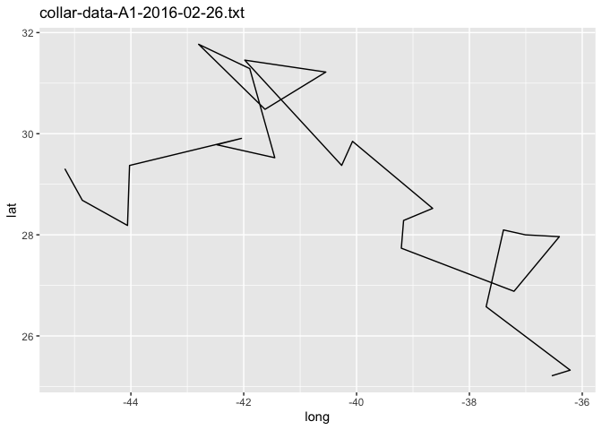
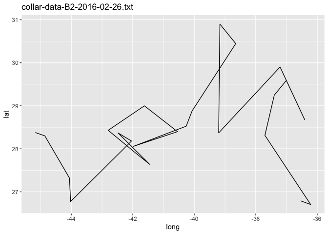
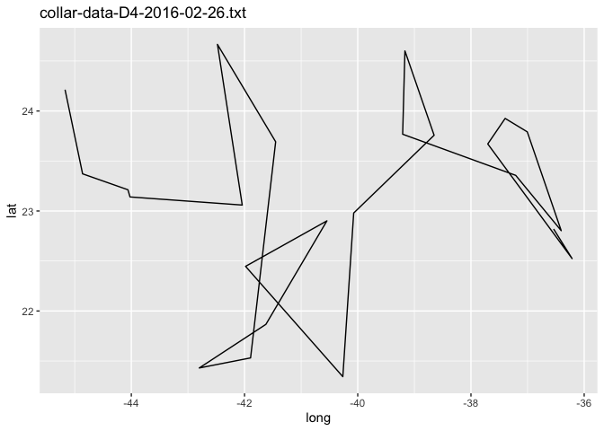
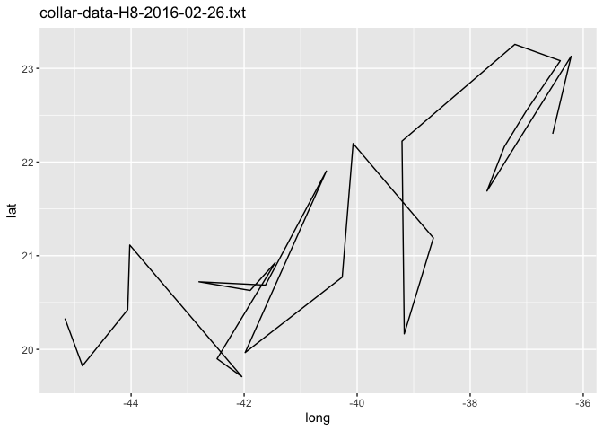
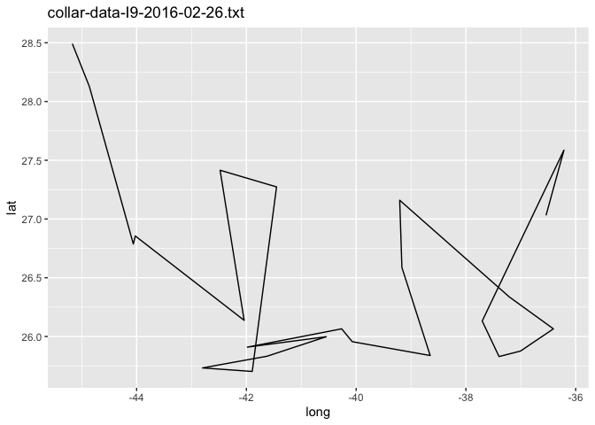
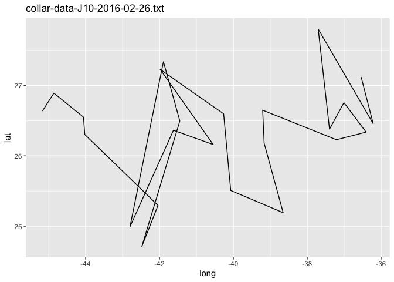
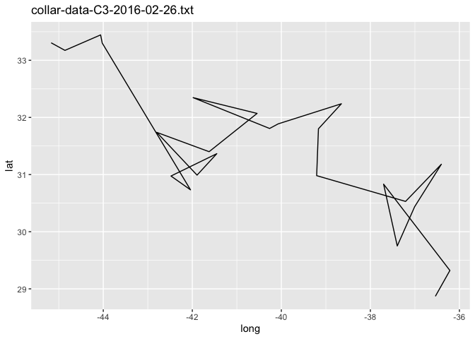
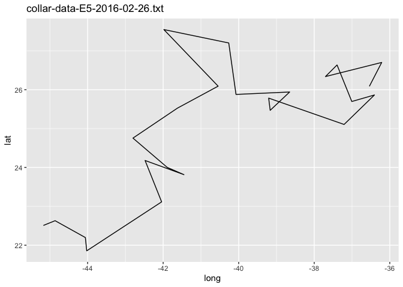
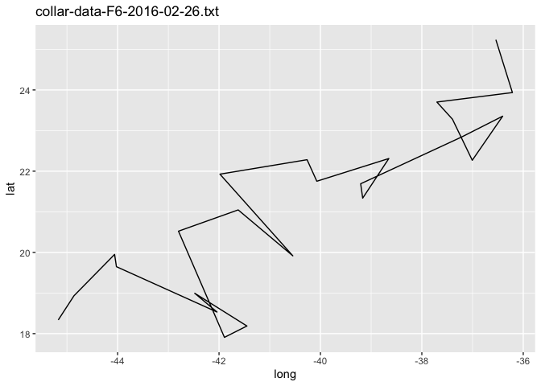
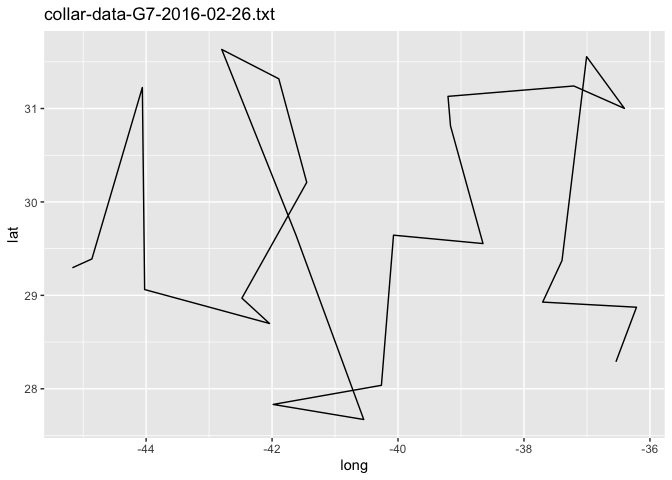

# Week 13 Assignment
Cielo De La Rosa Meza
2026-11-24

# Assignment

### Purpose

The goal of this assignment is to practice writing and using for loops
for iteration.

### Task

Write R code to successfully answer each question below.

### Criteria for Success

- Code is within the provided code chunks or new code chunks are created
  where necessary
- Code chunks run without errors
- Code chunks have brief comments indicating which code is answering
  which part of the question
- Code will be assessed as follows:
  - Produces the correct answer using the requested approach: 100%
  - Generally uses the right approach, but a minor mistake results in an
    incorrect answer: 90%
  - Attempts to solve the problem and makes some progress using the core
    concept, but returns the wrong answer and does not demonstrate
    comfort with the core concept: 50%
  - Answer demonstrates a lack of understanding of the core concept: 0%
- Any questions requiring written answers are answered with sufficient
  detail

### Due Date

Nov 24 before class

# Assignment Exercises

### Set Up

Be sure to load the `tidyverse` to use later in the assignment.

``` r
library(tidyverse)
```

    ── Attaching core tidyverse packages ──────────────────────── tidyverse 2.0.0 ──
    ✔ dplyr     1.2.1     ✔ readr     2.2.0
    ✔ forcats   1.0.1     ✔ stringr   1.6.0
    ✔ ggplot2   4.0.3     ✔ tibble    3.3.1
    ✔ lubridate 1.9.5     ✔ tidyr     1.3.2
    ✔ purrr     1.2.2     
    ── Conflicts ────────────────────────────────────────── tidyverse_conflicts() ──
    ✖ dplyr::filter() masks stats::filter()
    ✖ dplyr::lag()    masks stats::lag()
    ℹ Use the conflicted package (<http://conflicted.r-lib.org/>) to force all conflicts to become errors

``` r
library(ggplot2)
```

### 1. For Loop Basics (30 pts)

Complete the following tasks.

**HINT!** I recommend copying the commented code and making changes to
the copy. That way, if you have made edits that you haven’t kept track
of, you have the original code to start over as needed.

1.  The code below prints the numbers 1 through 5 one line at a time.
    Modify it to print each of these numbers multiplied by 3.

``` r
numbers <- c(1, 2, 3, 4, 5)
# for (number in numbers){
#   print(number)
# }
```

``` r
# 1a. modify to multiply each by 3 
numbers <- c(1, 2, 3, 4, 5)

for (number in numbers) { 
  multiply <- number * 3 
  print(multiply) 
  }
```

    [1] 3
    [1] 6
    [1] 9
    [1] 12
    [1] 15

2.  Write a for loop that loops over the following vector and prints out
    the mass in kilograms (`mass_kg = mass_lb / 2.2`)

``` r
# 1b. print mass in kg
mass_lbs <- c(2.2, 3.5, 9.6, 1.2)

for (mass in mass_lbs) {
  mass_kg <- mass / 2.2
  print(mass_kg)
}
```

    [1] 1
    [1] 1.590909
    [1] 4.363636
    [1] 0.5454545

3.  Complete the code below so that it prints out the name of each bird
    one line at a time.

``` r
# birds <- c("robin", "woodpecker", "blue jay", "sparrow")
# for (i in 1:length(_________)){
#   print(birds[__])
# }

# 1c. print out name of each bird 
birds <- c("robin", "woodpecker", "blue jay", "sparrow")
for (i in 1:length(birds)){
   print(birds[i])
  }
```

    [1] "robin"
    [1] "woodpecker"
    [1] "blue jay"
    [1] "sparrow"

4.  Complete the code below so that it stores one area for each radius.

``` r
# 1d. store one area for each radius

radius <- c(1.3, 2.1, 3.5)
# areas <- vector(_____ = "numeric", length = ______)
# for (__ in 1:length(________)){
#   areas[__] <- pi * radius[i] ^ 2
# }
# areas 

# make empty vector
areas <- vector(mode = "numeric", length = length(radius))

# write four loop 
for (i in 1:length(radius)){
  areas[i] <- pi * radius[i] ^ 2
  }
# print 
areas 
```

    [1]  5.309292 13.854424 38.484510

5.  Complete the code below to calculate an area for each pair of
    `lengths` and `widths`, store the areas in a vector, and after they
    are all calculated print them out:

``` r
lengths <- c(1.1, 2.2, 1.6)
widths <- c(3.5, 2.4, 2.8)
# areas <- vector(length = __________)
# for (i in _____) {
#   areas[__] <- lengths[__] * widths[__]
# }
# areas 

# 1e. calculate area for each pair and store in vector 

# empty vector
areas <- vector(length = length(areas))

# write for loop
for (i in 1:length(areas)) {
  areas[i] <- lengths[i] * widths[i]
  }

# print 
areas
```

    [1] 3.85 5.28 4.48

### 2. Size Estimates by Name (30 pts)

This is a followup to “Size Estimates by Name” from last week.

Download the `dinosaur_lengths.csv` file from D2L and place it in the
correct directory. Read the file into R.

Write a function `mass_from_length()` that uses the equation
`mass <- a * length^b` to estimate the size of a dinosaur from its
length. This function should take two arguments, `length` and `species`.
For each of the following inputs for `species`, so use the associated
`a` and `b` values to estimate the species mass using these equations:

- *Stegosauria*: `mass = 10.95 * length ^ 2.64` ([Seebacher
  2001](http://www.jstor.org/stable/4524171)).
- *Theropoda*: `mass = 0.73 * length ^ 3.63` ([Seebacher
  2001](http://www.jstor.org/stable/4524171)).
- *Sauropoda*: `mass = 214.44 * length ^ 1.46` ([Seebacher
  2001](http://www.jstor.org/stable/4524171)).
- For any other value of `species`: `mass = 25.37 * length ^ 2.49`

1.  Use this function and a `for` loop to calculate the estimated mass
    for each dinosaur, store the masses in a vector, and after all of
    the calculations are complete show the first few items in the vector
    using `head()`.
2.  Add the results in the vector back to the original data frame. Show
    the first few rows of the data frame using `head()`.
3.  Calculate the mean mass for each `species` using `dplyr` (no `for`
    loops).

``` r
# introduce data
dino_lengths <- read_csv("../data/dinosaur_lengths.csv")
```

    Rows: 500 Columns: 2
    ── Column specification ────────────────────────────────────────────────────────
    Delimiter: ","
    chr (1): species
    dbl (1): lengths

    ℹ Use `spec()` to retrieve the full column specification for this data.
    ℹ Specify the column types or set `show_col_types = FALSE` to quiet this message.

``` r
# print first 6 rows 
head(dino_lengths)
```

    # A tibble: 6 × 2
      species      lengths
      <chr>          <dbl>
    1 Stegosauria     18.5
    2 Ankylosauria    16.4
    3 Ankylosauria    23.7
    4 Sauropoda       23.9
    5 Ankylosauria    21.7
    6 Ankylosauria    21.4

``` r
# function that takes length & name, returns estimated mass 
get_mass_from_length <- function(length, species) { 
  if (species == "Stegosauria") { 
      mass <-  10.95 * length ^ 2.64 
  } else if (species == "Theropoda") { 
    mass <- 0.73 * length ^ 3.63 
  } else if (species == "Sauropoda") { 
    mass <- 214.44 * length ^ 1.46
  } else { 
    mass <- 25.37 * length ^ 2.49
  } 
  return(mass)
} 
```

``` r
# 2a. use function and for loop to calculate the estimated mass for each dinosaur. store in a vector and show first few items in vector using head() 

# create vector
dino_mass_calculation <- vector(length = length(dino_lengths))
  
# make for loop with function  
for (i in 1:nrow(dino_lengths)) {
  dino_mass_calculation[i] <- get_mass_from_length(length = dino_lengths$lengths[i], 
                                                   species = dino_lengths$species[i])
}

head(dino_mass_calculation)
```

    [1] 24341.68 27017.90 67453.38 22114.19 53884.76 52026.34

``` r
# 2b. Add the results in the vector back to the original data frame. Show the first few rows of the data frame using head(). 
dino_lengths$mass <- dino_mass_calculation

# print first 6 rows 
head(dino_lengths)
```

    # A tibble: 6 × 3
      species      lengths   mass
      <chr>          <dbl>  <dbl>
    1 Stegosauria     18.5 24342.
    2 Ankylosauria    16.4 27018.
    3 Ankylosauria    23.7 67453.
    4 Sauropoda       23.9 22114.
    5 Ankylosauria    21.7 53885.
    6 Ankylosauria    21.4 52026.

``` r
# 2c. Calculate the mean mass for each species using dplyr (no for loops).

dino_lengths |> 
  group_by(species) |> 
  summarize(mean_mass = mean(mass)) 
```

    # A tibble: 4 × 2
      species      mean_mass
      <chr>            <dbl>
    1 Ankylosauria    46819.
    2 Sauropoda       16104.
    3 Stegosauria     31924.
    4 Theropoda       45572.

### 3. Multi-file Analysis (20 pts)

You have satellite collars on a number of different individuals and want
to be able to quickly look at all of their recent movements at once. The
data is posted daily to a URL that contains one csv file for each
individual: zip file

Start your solution by:

- Download the zip file from the link above. Place the zip file in the
  appropriate sub-directory, if you have them.
- Unzip it using the `unzip()` function
- Obtain a list of all of the files with file names matching the pattern
  `"collar-data-.*.txt"` (using `list.files()`)

``` r
collar_files <- list.files(path = "../data/individual_collar_data/", 
                           pattern = "collar-data-.*.txt") 
collar_files 
```

     [1] "collar-data-A1-2016-02-26.txt"  "collar-data-B2-2016-02-26.txt" 
     [3] "collar-data-C3-2016-02-26.txt"  "collar-data-D4-2016-02-26.txt" 
     [5] "collar-data-E5-2016-02-26.txt"  "collar-data-F6-2016-02-26.txt" 
     [7] "collar-data-G7-2016-02-26.txt"  "collar-data-H8-2016-02-26.txt" 
     [9] "collar-data-I9-2016-02-26.txt"  "collar-data-J10-2016-02-26.txt"

1.  Use a loop to load each of these files into R and make a line plot
    (using `geom_path()`) for each file with `long` on the `x` axis and
    `lat` on the `y` axis.

    Graphs, like other types of output, won’t display inside a loop
    unless you explicitly display them, so you need put your `ggplot()`
    command inside a `print()` statement. Do this by saving the output
    of the ggplot function as an object and then printing that object.

    Include the name of the file in the graph as the graph title using
    the `labs` function (`labs(title = ...)`).

2.  Add code to the loop to calculate the minimum and maximum latitude
    in the file, and store these values, along with the name of the
    file, in a data frame.

    Show the data frame as output.

``` r
# 3a. use loop to load each files and make line plot for each 

# get number of files 
num_collar_files <- length(collar_files)

for (i in 1:num_collar_files) {
  # read in file 
  filename <- collar_files[i] 
  collar_locations <- read.csv(paste0("../data/individual_collar_data/", filename)) 
  # add plot 
  plot <- ggplot(collar_locations, aes(x = long, y = lat)) + 
    geom_path() + 
    labs(title = filename)
  # print plot 
  print(plot)
}
```















``` r
# 3b. Add code to the loop to calculate the minimum and maximum latitude in the file, and store these values, along with the name of the file, in a data frame. Show the data frame as output.

# create empty object 
collar_data_frame <- data.frame(file_name = vector("character", num_collar_files), 
                                                   max_lat = vector("numeric", num_collar_files), 
                                                   min_lat = vector("numeric", num_collar_files), 
                                observations = vector("numeric", num_collar_files))

collar_data_frame 
```

       file_name max_lat min_lat observations
    1                  0       0            0
    2                  0       0            0
    3                  0       0            0
    4                  0       0            0
    5                  0       0            0
    6                  0       0            0
    7                  0       0            0
    8                  0       0            0
    9                  0       0            0
    10                 0       0            0

``` r
# for loop 
for (i in 1:num_collar_files) {
  # read in file 
  filename <- collar_files[i] 
  collar_locations <- read.csv(paste0("../data/individual_collar_data/", filename)) 
  # add plot 
  plot <- ggplot(collar_locations, aes(x = long, y = lat)) + 
    geom_path() + 
    labs(title = filename)
  # print plot 
  print(plot) 
  # add info to the df 
  collar_data_frame$file_name[i] <- filename
  collar_data_frame$max_lat[i] <- max(collar_locations$lat)
  collar_data_frame$min_lat[i] <- min(collar_locations$lat)
  collar_data_frame$observations[i] <- nrow(collar_locations)
   
}
```












``` r
# print df 

collar_data_frame
```

                            file_name  max_lat  min_lat observations
    1   collar-data-A1-2016-02-26.txt 31.76912 25.21080           24
    2   collar-data-B2-2016-02-26.txt 30.89907 26.70509           24
    3   collar-data-C3-2016-02-26.txt 33.44421 28.86998           24
    4   collar-data-D4-2016-02-26.txt 24.66598 21.34315           24
    5   collar-data-E5-2016-02-26.txt 27.54663 21.85565           24
    6   collar-data-F6-2016-02-26.txt 25.23623 17.90788           24
    7   collar-data-G7-2016-02-26.txt 31.63272 27.67120           24
    8   collar-data-H8-2016-02-26.txt 23.25601 19.70875           24
    9   collar-data-I9-2016-02-26.txt 28.49172 25.70252           24
    10 collar-data-J10-2016-02-26.txt 27.80325 24.71200           24

### 4. DNA or RNA (20 points)

This question has you write a function and then use the function in
several different forms of iteration.

1.  Write a function that determines if a sequence of base pairs is DNA,
    RNA, or if it is not possible to tell given the sequence provided.
    RNA has the base Uracil (“u”) instead of the base Thymine (“t”), so
    sequences that contain a “u” are RNA, sequences with a “t” are DNA,
    and sequences with neither are unknown.

    Name the function `dna_or_rna()` and have it take `sequence` as an
    argument. Have the function return one of three outputs: “DNA”,
    “RNA”, or “UNKNOWN”.

    *HINT: Remember our work with character strings and the `stringr`
    package from the `tidyverse` (Week 7)?*

``` r
# write your function here

dna_or_rna <- function(sequence) {
  if (str_detect(sequence, "u")) {
    result <- "RNA" 
  } else if (str_detect(sequence, "t")) {
    result <- "DNA" 
  } else {
    result  <- "UNKNOWN"
  }
  return(result)
}
```

2.  Use the function to determine the sequence type for the following
    sequences.

``` r
seq1 <- "ttgaatgccttacaactgatcattacacaggcggcatgaagcaaaaatatactgtgaaccaatgcaggcg"
seq2 <- "gauuauuccccacaaagggagugggauuaggagcugcaucauuuacaagagcagaauguuucaaaugcau"
seq3 <- "gaaagcaagaaaaggcaggcgaggaagggaagaagggggggaaacc"


dna_or_rna(seq1)
```

    [1] "DNA"

``` r
dna_or_rna(seq2)
```

    [1] "RNA"

``` r
dna_or_rna(seq3)
```

    [1] "UNKNOWN"

Before tackling the next questions (c-g), run the following code chunk
to create a vector called sequences.

``` r
sequences <- c("ttgaatgccttacaactgatcattacacaggcggcatgaagcaaaaatatactgtgaaccaatgcaggcg",
              "gauuauuccccacaaagggagugggauuaggagcugcaucauuuacaagagcagaauguuucaaaugcau",
              "gaaagcaagaaaaggcaggcgaggaagggaagaagggggggaaacc",
              "guuuccuacaguauuugaugagaaugagagcaccugaucagguggauaaggaagaugaagacu",
              "gauaaggaagaugaagacuuucaggaaucuaauaaaaugcacuccaugaauggauucauguaugggaaucagccggguc")
```

3.  Use the function you wrote and a `for` loop to create a vector of
    sequence types for the values in sequences

4.  Use the function and a `for` loop to create a data frame that
    includes a column of sequences and a column of their types.

5.  This time, instead of using the function, place the `if`-`else`
    portion of your function directly into the `for` loop. Modify the
    code so that it successfully creates the same output as (d) above.
    Remember to “reset” the data frame that will hold the output so it
    is empty before you start your loop.

6.  OPTIONAL: Use the function and `sapply` to create a vector of
    sequence types for the values in sequences

7.  OPTIONAL: Use the function, and `mutate()` to create a data frame
    that includes a column of sequences and a column of their types.
    First, run the following line of code to turn the sequence vector
    into a data frame.

``` r
# 4c. Use the function you wrote and a for loop to create a vector of sequence types for the values in sequences  

# create empty vector 
results <-  vector("character", length(sequences))

for (i in 1:length(sequences)) { 
  results[i] <- dna_or_rna(sequences[i])
} 

# print output 
results 
```

    [1] "DNA"     "RNA"     "UNKNOWN" "RNA"     "RNA"    

``` r
# 4d. Use the function and a for loop to create a data frame that includes a column of sequences and a column of their types. 

# create empty df
results_dataframe <- data.frame(type = vector("character", length(sequences)), 
                                sequence = vector("character", length(sequences)
                                )) 

# for loop 
for (i in 1:length(sequences)) { 
  results_dataframe$sequence[i] <- sequences[i] 
  results_dataframe$type[i] <- dna_or_rna(sequences[i])
} 

results_dataframe
```

         type
    1     DNA
    2     RNA
    3 UNKNOWN
    4     RNA
    5     RNA
                                                                             sequence
    1          ttgaatgccttacaactgatcattacacaggcggcatgaagcaaaaatatactgtgaaccaatgcaggcg
    2          gauuauuccccacaaagggagugggauuaggagcugcaucauuuacaagagcagaauguuucaaaugcau
    3                                  gaaagcaagaaaaggcaggcgaggaagggaagaagggggggaaacc
    4                 guuuccuacaguauuugaugagaaugagagcaccugaucagguggauaaggaagaugaagacu
    5 gauaaggaagaugaagacuuucaggaaucuaauaaaaugcacuccaugaauggauucauguaugggaaucagccggguc

``` r
# 4e. This time, instead of using the function, place the if-else portion of your function directly into the for loop. Modify the code so that it successfully creates the same output as (d) above. Remember to "reset" the data frame that will hold the output so it is empty before you start your loop. 

# create empty df
results_dataframe <- data.frame(type = vector("character", length(sequences)), 
                                sequence = vector("character", length(sequences)
                                )) 
 
# for loop with if else statement inside 
for (i in 1:length(sequences)) { 
  # put sequences in column
  results_dataframe$sequence[i] <- sequences[i]  
  # if else portion of function 
  if (str_detect(sequences[i], "u")) {
    result <- "RNA" 
  } else if (str_detect(sequences[i], "t")) {
    result <- "DNA" 
  } else {
    result  <- "UNKNOWN"
  }
  results_dataframe$type[i] <- result
  }

results_dataframe
```

         type
    1     DNA
    2     RNA
    3 UNKNOWN
    4     RNA
    5     RNA
                                                                             sequence
    1          ttgaatgccttacaactgatcattacacaggcggcatgaagcaaaaatatactgtgaaccaatgcaggcg
    2          gauuauuccccacaaagggagugggauuaggagcugcaucauuuacaagagcagaauguuucaaaugcau
    3                                  gaaagcaagaaaaggcaggcgaggaagggaagaagggggggaaacc
    4                 guuuccuacaguauuugaugagaaugagagcaccugaucagguggauaaggaagaugaagacu
    5 gauaaggaagaugaagacuuucaggaaucuaauaaaaugcacuccaugaauggauucauguaugggaaucagccggguc

``` r
seq_df <- as.data.frame(sequences)
```

## Turning in Your Assignment

As with the last few weeks, you will be submitting your assignment by
submitting the link to your GitHub repository.

**Remember!** You should “Render” your assignments to markdown (.md)
files and push all files, including the `.md` file, to GitHub.
